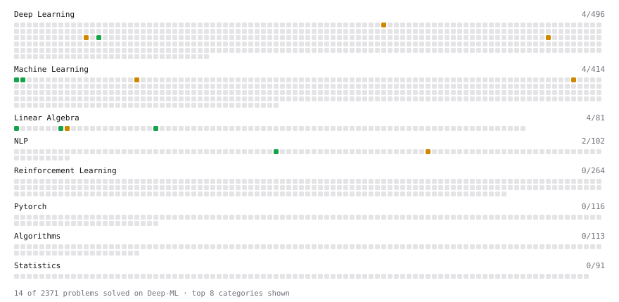

# Deep-ML

My machine learning practice from [Deep-ML](https://www.deep-ml.com). Every solution here was written by hand.

**23** solved · 16 problems · 0 labs · 7 math

[**Browse the interactive portfolio**](https://9santa.github.io/deep-ml/) to replay this filling in over time.

## Problems

| | Difficulty | Solved | |
| --- | --- | --- | --- |
| [BPE Decode Token IDs to Text](https://www.deep-ml.com/problems/951) | easy | 2026-11-23 | [solution](problems/0951-bpe-decode-token-ids-to-text) |
| [Calculate 2x2 Matrix Inverse](https://www.deep-ml.com/problems/8) | easy | 2026-10-31 | [solution](problems/0008-calculate-2x2-matrix-inverse) |
| [Calculate LoRA Trainable Parameter Count vs Full Fine-Tuning](https://www.deep-ml.com/problems/867) | easy | 2026-11-23 | [solution](problems/0867-calculate-lora-trainable-parameter-count-vs-full-fine-tuning) |
| [Implement Orthogonal Projection of a Vector onto a Line](https://www.deep-ml.com/problems/66) | easy | 2026-10-31 | [solution](problems/0066-implement-orthogonal-projection-of-a-vector-onto-a-line) |
| [Linear Regression Using Gradient Descent](https://www.deep-ml.com/problems/15) | easy | 2026-11-02 | [solution](problems/0015-linear-regression-using-gradient-descent) |
| [Linear Regression Using Normal Equation](https://www.deep-ml.com/problems/14) | easy | 2026-10-31 | [solution](problems/0014-linear-regression-using-normal-equation) |
| [Matrix-Vector Dot Product](https://www.deep-ml.com/problems/1) | easy | 2026-10-31 | [solution](problems/0001-matrix-vector-dot-product) |
| [Regex-Based Text Tokenizer](https://www.deep-ml.com/problems/940) | easy | 2026-11-20 | [solution](problems/0940-regex-based-text-tokenizer) |
| [BPE Encode Text Using Merge Table](https://www.deep-ml.com/problems/950) | medium | 2026-11-23 | [solution](problems/0950-bpe-encode-text-using-merge-table) |
| [Implement Gradient Descent Variants with MSE Loss](https://www.deep-ml.com/problems/47) | medium | 2026-11-07 | [solution](problems/0047-implement-gradient-descent-variants-with-mse-loss) |
| [LoRA: Low-Rank Adaptation Forward Pass](https://www.deep-ml.com/problems/222) | medium | 2026-11-22 | [solution](problems/0222-lora-low-rank-adaptation-forward-pass) |
| [Mask Instruction Tokens for Loss Computation](https://www.deep-ml.com/problems/1066) | medium | 2026-11-21 | [solution](problems/1066-mask-instruction-tokens-for-loss-computation) |
| [Masked Cross-Entropy Loss for Supervised Finetuning](https://www.deep-ml.com/problems/795) | medium | 2026-11-22 | [solution](problems/0795-masked-cross-entropy-loss-for-supervised-finetuning) |
| [Matrix times Matrix ](https://www.deep-ml.com/problems/9) | medium | 2026-10-31 | [solution](problems/0009-matrix-times-matrix) |
| [Numerical Gradient Checking](https://www.deep-ml.com/problems/313) | medium | 2026-11-07 | [solution](problems/0313-numerical-gradient-checking) |
| [Recursively Replace Linear Layers with LoRA](https://www.deep-ml.com/problems/1074) | medium | 2026-11-23 | [solution](problems/1074-recursively-replace-linear-layers-with-lora) |

## Math

| | Difficulty | Solved | |
| --- | --- | --- | --- |
| [Derivatives and Gradients](https://www.deep-ml.com/math-problems/1) | easy | 2026-11-02 | [solution](math/0001-derivatives-and-gradients) |
| [Gradient Descent Updates](https://www.deep-ml.com/math-problems/5) | easy | 2026-11-02 | [solution](math/0005-gradient-descent-updates) |
| [LoRA Parameter and Compute Arithmetic](https://www.deep-ml.com/math-problems/154) | easy | 2026-11-21 | [solution](math/0154-lora-parameter-and-compute-arithmetic) |
| [Inverse and Rank](https://www.deep-ml.com/math-problems/12) | medium | 2026-10-31 | [solution](math/0012-inverse-and-rank) |
| [Least Squares and the Normal Equations](https://www.deep-ml.com/math-problems/34) | medium | 2026-10-31 | [solution](math/0034-least-squares-and-the-normal-equations) |
| [Matrix Multiplication](https://www.deep-ml.com/math-problems/10) | medium | 2026-10-30 | [solution](math/0010-matrix-multiplication) |
| [Orthogonality and Projections](https://www.deep-ml.com/math-problems/14) | medium | 2026-10-31 | [solution](math/0014-orthogonality-and-projections) |

---

_This file is regenerated by Deep-ML on every push._
